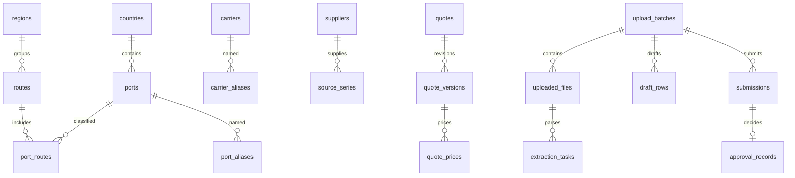

# 任务三：数据结构与基础资料

日期：2026-10-25；数据库结构版本：2。基础资料接口已实现；报价、提取及审批目前仅建立数据结构，流程留后续任务。

## 数据关系

| 表 | 用途／关键约束 |
| --- | --- |
| application_meta、schema_migrations | 安装身份、默认起运港、已执行迁移；沿用任务二数据 |
| countries、regions、routes | 国家／地区、模板工作表区域、航线分组；可维护和停用 |
| ports、port_routes | 独立港口ID；国家＋规范英文名＋规范码头区分；一个港口可归属多条航线 |
| port_aliases | 一个别名可指向不同港口；只有人工确认且启用的别名参与检索 |
| carriers、carrier_aliases | 承运人与常用别名；规范化大小写、空格、全半角后判重 |
| suppliers、source_series | 报价供应商与协议／系列；同供应商内系列名称判重，不将文件名当身份 |
| users | 预留账号、密码哈希、角色、停用状态；任务九前不创建真实账号或权限流程 |
| quotes、quote_versions | 报价身份和修订；每个报价最多一个当前版本；保留前版、港口、航线、承运人、来源、路径及日期 |
| quote_prices | 每版本每箱型一行；金额用整数分存储，避免浮点；空价没有对应行，0价须明确确认 |
| upload_batches、uploaded_files | 草稿批次、文件身份、存储位置、摘要及大小 |
| extraction_tasks、draft_rows | 任务状态及原始输出；保留原始和编辑后JSON、字段动作、校验与预期目标版本 |
| source_evidence | 正式／草稿报价关联原文件、工作表单元格、页码、图片区域；手工录入可记录依据 |
| submissions、approval_records | 冻结提交快照、批次版本、审批人／决定；唯一提交版本和唯一审批操作标识 |
| audit_events | 资料维护及后续业务操作前后值、操作者和时间 |
| catalog_imports、catalog_evidence | 目录来源文件摘要、导入指纹、原工作表行和原始字段 |

共26张表（含任务二2张元数据表）。外键每次连接启用；迁移使用事务，失败不留下半迁移版本。
正式报价表具备日期格式／顺序、币种格式、服务类型、引用关系、箱型、金额非负及零价确认等约束。
“正式版本至少一种价格”“审批权限”“日期重叠处理”“提交快照不可改写”等跨记录业务规则，将在任务四／六／九的服务层及相应验收中实施；本阶段不声称仅靠建表已完成发布流程。

## 字段映射

- F01：routes；F02～F05：countries／ports；F06：carriers。
- F07～F09：quote_prices（20GP／40GP／40HQ，amount_minor单位分）。
- F10～F13、F15～F18、F21～F23：quote_versions的币种、船期、航程、服务、备注、有效期、口径、费用和条件字段。
- F14：source_series关联suppliers。F19／F20：quote_versions起运／目的港外键；默认起运港在application_meta。
- F24：quotes／quote_versions身份、版本与审计，submissions／approval_records留审批依据。
- F25：source_evidence关联uploaded_files、extraction_tasks、draft_rows、quote_versions；原始结果单独保存。

## 模板目录导入

`scripts/build_port_directory.py`读取指定的固定模板，生成随项目交付的`backend/resources/port-directory.json`。
初次启动导入该快照，后续同指纹跳过，不覆盖人工修改，也不依赖微信临时文件路径继续存在。

处理规则：按工作簿关系找到六个表；验证A～E表头；仅在明确合并范围内展开航线；在连续港口行中继承国家；分隔行及新航线清空国家上下文；缺国家／航线时报错，不跨分组补猜；忽略空港口行，不读取或生成运价。

| 工作表 | 导入目录数 |
| --- | ---: |
| 美洲航线 | 69 |
| 欧洲航线 | 61 |
| 美加航线 | 27 |
| 亚洲航线 | 68 |
| 非洲航线 | 49 |
| 中东印巴航线 | 21 |
| 合计 | 295 |

另建立默认青岛起运港，共296个港口／交付点、107个国家／地区标签、6区域、34航线。
107项是原表标签归一后的统计，不代表107个主权国家。内陆点、地区划分和中文译名保留原表，不自动纠正或认证。
船公司、供应商、协议系列初始为空，供按真实业务维护；没有预置虚构报价。

原模板SHA-256：`9bed77356ca6cba8a5558e8ac61d3a340d94fe3567ccb12a3b1e2f41f21a220b`。
港口ID按国家、原始英文名和码头生成；后续编辑名称仍保留原ID。名称不用于报价外键身份。

## 维护页面与接口

首页下方“维护基础资料”进入；支持九类资料新增、编辑、启用／停用；不提供物理删除。
默认青岛不可停用。关联对象必须存在；新增关联不能引用停用对象；编辑既有停用关联可保留。
编辑附带revision，旧版本保存返回409，要求刷新。所有保存通过事务写入前后值记录；当前actor_label明确标记为“本机维护”，没有冒充已登录管理员。

- `GET /api/catalog/summary`：统计、默认起运港、目录来源。
- `GET /api/catalog/{kind}?q=...&include_inactive=false`：资料列表；中英文和有效别名检索；多候选不自动选中。
- `POST /api/catalog/{kind}`：新增（只接受该类允许的字段）。
- `PUT /api/catalog/{kind}/{id}?expected_revision=N`：编辑与停用。
- `GET /api/catalog/ports/{id}/evidence`：查看模板来源。

kind允许countries、regions、routes、ports、port_aliases、carriers、carrier_aliases、suppliers、source_series。
API不允许任意表名或字段；参数校验、重复冲突和引用错误返回明确提示。

## 当前限制

维护操作仅用于本机开发阶段，任务九接入账号权限后才用于多用户正式运行。上传、报价查询、审批和报价Excel导入导出尚未实现。
港口代码字段只用于录入人工核对过的代码；初始目录全部留空。
基础资料名称的修改有审计；未来正式报价／审批快照须保留提交时文本，不能只依赖可变字典名称重建历史展示。
